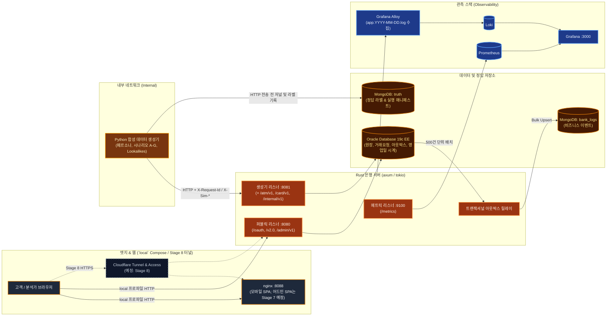
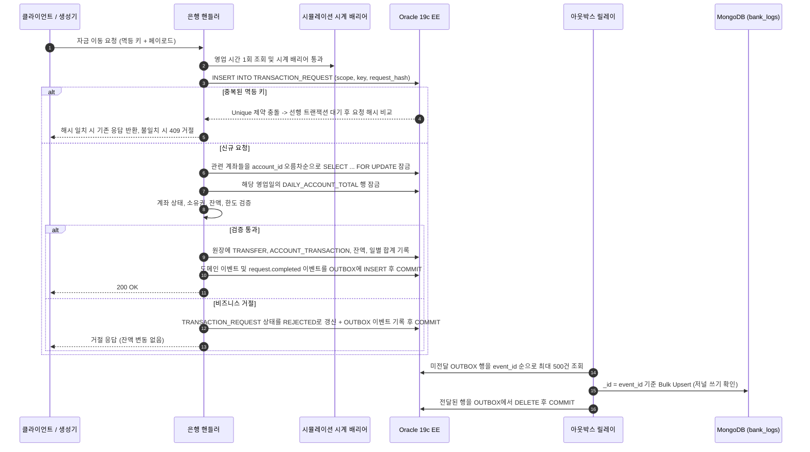

<div align="center">

# Saltation

**실시간 이상거래 탐지(FDS) 및 MLOps 파이프라인을 위한 오픈뱅킹 규격 시뮬레이션 은행 서버 & 합성 사기 데이터 생성기**

[English](README.md) | **한국어**

<br />


</div>

---

> **sal·ta·tion (도약, `/sælˈteɪʃən/`)** — 바람이나 모래 아래의 진동으로 사막의 모래알들이 사구(dune) 위를 튀어 오르며 이동하는 현상.
>
> 영화 **《듄》(Dune)**에서 튀어 오르는 모래알로 모래 아래 보이지 않는 움직임을 읽어내듯, 정지된 테이블 속 거래 한 건은 다른 모래알과 구별되지 않지만 끊임없이 흐르는 이벤트 스트림 속에서는 숨은 이상 패턴이 드러납니다.

---

## 목차

- [개요](#개요)
- [시스템 아키텍처](#시스템-아키텍처)
- [엔지니어링 설계](#엔지니어링-설계)
  - [1. 단일 원화(KRW) 원장 및 잠금 순서](#1-단일-원화krw-원장-및-잠금-순서)
  - [2. Plain Oracle SQL 및 순수 Rust `oracledb` 세션 풀](#2-plain-oracle-sql-및-순수-rust-oracledb-세션-풀)
  - [3. 트랜잭셔널 아웃박스 및 백프레셔](#3-트랜잭셔널-아웃박스-및-백프레셔)
  - [4. 시뮬레이션 영업일 시계 및 일마감](#4-시뮬레이션-영업일-시계-및-일마감)
  - [5. 채널 구성: 오픈뱅킹, ATM, 체크카드망](#5-채널-구성-오픈뱅킹-atm-체크카드망)
  - [6. API 요청 결과 및 거절된 거래 시도 기록](#6-api-요청-결과-및-거절된-거래-시도-기록)
- [사기 시나리오 (A–G), 페르소나 및 정답 라벨](#사기-시나리오-ag-페르소나-및-정답-라벨)
- [저장소 디렉토리 구조](#저장소-디렉토리-구조)
- [빠른 시작](#빠른-시작)
- [검증 및 체크](#검증-및-체크)
- [단계별 구현 로드맵](#단계별-구현-로드맵)
- [SDLC 컨트롤 플레인](#sdlc-컨트롤-플레인)

---

## 개요

공개된 금융 사기 데이터셋은 정적 테이블 형태여서 실시간 이벤트 스트림이나 로그인·기기·세션 컨텍스트, 다중 채널(모바일 앱, ATM, 카드 결제망) 이력이 없고, 새로운 사기 패턴을 주입해 파이프라인의 반응을 측정할 수도 없습니다. 반면 실제 은행 데이터는 개인정보 및 법적 규제로 외부에서 사용할 수 없습니다.

Saltation은 실시간 금융 이상거래 탐지(FDS) MLOps 파이프라인의 데이터 소스를 제공하기 위해 구축한 시뮬레이션 은행 서버이자 합성 트래픽 생성기입니다.

1. **은행 서버 (`bank/`)**: [금융결제원 오픈뱅킹공동업무 이용기관 API 명세서 v3.3.6](spec.md)과 금융 마이데이터(MyData) 은행권 논리 데이터 모델을 기반으로 **Oracle Database 19c Enterprise Edition**의 29개 테이블 위에 구현한 Rust API 서버입니다. 입출금 계좌, 이체, 수취인, 무이자 정기예금 및 대출, 체크카드 결제, 인증, 기기/세션 추적을 3개 채널(모바일 웹 API, 시뮬레이션 ATM, 시뮬레이션 카드망)과 분석가용 읽기 전용 어드민 API로 제공합니다.
2. **합성 활동 생성기 (`generator/`)**: 내부 시딩 인터페이스로 20,000명의 고객을 생성하고, 시뮬레이션 영업일 시계를 전진시키며 365영업일 분량의 과거 이력(Backfill)을 HTTP로 생성한 뒤 실시간(Live) 모드로 전환합니다. 일반 고객 페르소나(직장인, 학생, 자영업자, 고령층)와 사기 시나리오 **A~G**, 정상 유사 거래(Lookalikes)를 함께 구동하며, 정답 라벨은 은행 서버가 접근할 수 없는 별도 데이터베이스(`truth`)에 기록합니다.
3. **정형 원장 및 비정형 이벤트 스트림**: 관계형 원장 데이터는 Oracle Database에 저장하고, 비즈니스 이벤트(`saltation.log/1`)는 트랜잭셔널 아웃박스를 통해 MongoDB(`bank_logs`)로 전달하며, 운영 JSON 로그(`app.log`)와 Prometheus 메트릭은 Loki와 Grafana로 수집합니다.

---

## 시스템 아키텍처

아래 다이어그램은 현재 구현된 스택과 후속 단계인 **Stage 7**(어드민 SPA) 및 **Stage 8**(Cloudflare 터널 엣지, 점선 테두리) 구성을 함께 나타냅니다.



### 리스너 및 네트워크 경계

은행 서버는 분리된 Docker 네트워크(`edge`, `internal`, `data`, `obs`)에 세 개의 HTTP 리스너를 둡니다.

| 리스너 | 포트 / 네트워크 | 라우트 | 컨텍스트 처리 |
|---|---|---|---|
| **Public** | `:8080` (`edge`) | `/oauth/2.0/revoke`, 고객용 `/v2.0/**` (외부 타행 입금 제외), `/admin/v1/**` | `X-Sim-*` 헤더를 무시하고 (Stage 8 Cloudflare 연동 시) `CF-Connecting-IP` / `CF-IPCountry`에서 클라이언트 IP와 국가를 읽으며, 세션을 `human = true`로 기록합니다. |
| **Generator** | `:8081` (`internal`) | 퍼블릭 라우트 + `/v2.0/transfer/deposit/fin_num`, `/atm/v1/**`, `/card/v1/**`, `/internal/v1/**` | 호스트 외부로 노출되지 않는 내부 포트이며, `X-Request-Id`(ULID), `X-Sim-Ip`, `X-Sim-Region`, `X-Sim-Device` 헤더를 신뢰하고 `human = false`로 기록합니다. |
| **Metrics** | `:9100` (`obs`) | `/metrics` | `obs` 네트워크의 Prometheus가 요청 지연시간, SQL 구문별 실행 시간, 행 잠금 대기, 세션 풀 사용량, 아웃박스 지연, 일마감 불일치 지표를 수집합니다. |

---

## 엔지니어링 설계

### 1. 단일 원화(KRW) 원장 및 잠금 순서

계좌 잔액, `ACCOUNT_TRANSACTION` 행, `TRANSFER` 레코드, `DAILY_ACCOUNT_TOTAL` 행은 공유 원장 모듈([`bank/src/shared/ledger/`](bank/src/shared/ledger))만 수정합니다. 모든 원장 금액은 정수 원화(`NUMBER(15,0)`, 1원 ~ 999,999,999,999원)입니다.



- **잠금 순서**: 두 개 이상의 당행 계좌를 다루는 연산(`transfer`, `term_open`, `term_close`, `loan_disburse`, `loan_repay`)은 단일 Oracle 트랜잭션에서 대상 계좌들을 `account_id` 오름차순으로 `SELECT ... FOR UPDATE` 잠금합니다.
- **부호 규칙 (F-21)**:
  - 입출금 및 정기예금 계좌의 잔액은 보유 금액이고, 대출 계좌의 잔액은 상환할 대출 원금입니다.
  - 당행 계좌 간 `transfer`, `term_open`, `term_close`는 두 계좌에 절댓값이 같고 부호가 반대인 두 행을 기록합니다.
  - `loan_disburse`(대출 실행)와 `loan_repay`(대출 상환)는 연결 입출금 계좌와 대출 계좌에 금액과 부호가 같은 두 행을 기록합니다.
  - `card_payment`(체크카드 결제)는 카드 계좌에 음수 원화 금액(`-krw_amount`) 한 행을 기록합니다.

### 2. Plain Oracle SQL 및 순수 Rust `oracledb` 세션 풀

- **No ORM / No Query Builder**: 모든 SQL은 각 기능 슬라이스의 `sql/` 디렉토리(예: [`bank/src/features/transfers/sql/`](bank/src/features/transfers/sql))에 별도 `.sql` 파일로 작성되어 컴파일 타임에 임베딩되며, 바인드 변수로만 실행됩니다. 파일 상단 주석에 구문 이름, 목적, 예상 접근 경로(Access Path)를 적어 `EXPLAIN PLAN` 및 `DBMS_XPLAN.DISPLAY_CURSOR`로 확인합니다.
- **순수 Rust `oracledb` 어댑터 및 FIFO 세션 풀** ([`bank/src/shared/db/`](bank/src/shared/db)):
  - C 기반 Oracle Instant Client 라이브러리 없이 순수 Rust `oracledb` 드라이버를 사용합니다.
  - 어댑터가 자체 세션 풀을 관리하여 각 세션을 `+09:00`(KST)으로 초기화하고, 대기 요청에 도착 순서(FIFO)대로 세션을 할당하며, 획득 타임아웃 초과 시 재시도 가능한 `503` 응답을 반환합니다.
- **SQL 및 인덱스 튜닝** ([`docs/oracle-tuning-baseline.md`](docs/oracle-tuning-baseline.md), [`scripts/dev/oracle-tune/`](scripts/dev/oracle-tune)):
  - 20,000명 고객 및 3년 분량 시뮬레이션 스키마(`SALTATION_TUNE`)에서 ASH(Active Session History), 세션 카운터, `ALLSTATS LAST` 실행 계획을 기반으로 측정했습니다.
  - 요청당 중복 왕복 쿼리를 줄이고, 거래 내역 페이지네이션과 일마감 쿼리에 맞춰 인덱스 컬럼 순서를 조정했으며, 미사용 인덱스를 제거하고 복원된 아웃박스 워크로드의 옵티마이저 통계를 검증했습니다.

### 3. 트랜잭셔널 아웃박스 및 백프레셔

- **4 GB 상한 전용 테이블스페이스 (F-36a)**: `OUTBOX` 테이블은 자동 확장이 4 GB로 제한된 전용 테이블스페이스에 위치하여 이벤트 적체가 원장 저장 공간을 침범하지 않습니다. 테이블스페이스가 가득 차면 이벤트를 기록해야 하는 트랜잭션은 이벤트를 건너뛰지 않고 재시도 가능한 에러로 롤백됩니다.
- **배치 릴레이**: [`bank/src/features/outbox_relay/`](bank/src/features/outbox_relay)가 `event_id` 순서로 500건씩 읽어 MongoDB `bank_logs.events`(`_id = event_id`)에 Bulk Upsert(저널 확인)한 뒤 전달된 행을 Oracle에서 삭제합니다.
- **백프레셔 워터마크**: 백필 중 미전달 이벤트가 **50,000건**을 넘으면 생성기는 요청 전송과 시계 전진을 멈추고, **10,000건** 아래로 내려가면 재개합니다. `scripts/dev/it-oracle.sh outbox-outage`가 부하 상태에서 MongoDB를 120초간 중단시켜 이를 검증합니다.

### 4. 시뮬레이션 영업일 시계 및 일마감

- **이중 모드 시계** ([`bank/src/shared/clock/`](bank/src/shared/clock)): 영업 시간은 Oracle `SIM_CLOCK` 테이블에 저장됩니다. 모든 연산은 시작 시점에 영업 시간을 한 번 읽어 `occurred_at`(영업 시각)과 `recorded_at`(시스템 시각)을 기록하며, 영업 시간 컬럼에는 DB 기본값을 두지 않습니다.
- **시계 배리어**: `backfill` 모드에서 시계를 전진시킬 때는 진행 중인 연산이 끝날 때까지 최대 10초간 대기하고, 롤오버가 끝날 때까지 새 연산을 막습니다. `live` 모드로의 전환은 단방향이며 이후에는 시스템 시각을 따릅니다.
- **일마감 롤오버 작업** ([`bank/src/shared/rollover/`](bank/src/shared/rollover)): 영업일이 넘어갈 때마다 날짜 순서대로 등록된 작업이 실행됩니다.
  1. **정기예금 만기 처리**: 만기 계좌의 원금을 연결 입출금 계좌로 옮기고 정기예금 계좌를 닫습니다.
  2. **휴면 전환**: 365영업일 동안 고객 주도 거래가 없는 계좌를 `dormant`로 전환하고(이후 고객 거래 발생 시 `active`로 전환), `ACCOUNT_STATUS_HISTORY`에 기록합니다.
  3. **일마감 검증** ([`bank/src/features/daily_close/`](bank/src/features/daily_close)): 계좌 및 영업일별로 `기초 잔액 + 당일 거래 합계 == 당일 마지막 거래 후 잔액`과 `TRANSFER`의 F-21 부호 규칙을 검사해 `DAILY_CLOSE`에 저장합니다.

### 5. 채널 구성: 오픈뱅킹, ATM, 체크카드망

- **모바일 오픈뱅킹 (`/v2.0/**`)**: 금융결제원 v3.3.6 경로, 필드 길이(`aNS`, `N`, `AN`, 한글 문자 수 기준 `AH(n)`), 응답 코드를 따릅니다. 전화번호/비밀번호 로그인(5회 실패 시 30분 잠금), SMS 발송함 비밀번호 재설정, 기기 등록, 수취인 관리, 수취인 조회, 이체, 외부 이용기관 입금(`oob` 스코프), 정기예금, 대출을 제공합니다.
- **ATM 채널 (`/atm/v1/**`)**: 위·경도 좌표가 시딩된 국내 ATM 단말기 인터페이스로, PIN 3회 오류 시 익영업일까지 잠금, 3분 세션, 현금 출금 한도(1회 100만 원, 1일 600만 원)를 적용합니다.
- **체크카드망 채널 (`/card/v1/authorize`)**: `card` 스코프 클라이언트 자격증명으로 인증합니다. 5개 통화 고정 정수 환율(`KRW`, `USD` 1,300원, `EUR` 1,400원, `JPY` 100엔당 900원, `CNY` 200원), ISO 3166-1 alpha-2 국가 코드, 4자리 MCC, 대면(`in_person`) 결제 시 좌표를 검증하며 승인 및 거절 내역을 모두 기록합니다.

### 6. API 요청 결과 및 거절된 거래 시도 기록

- **`request.completed` 이벤트**: 퍼블릭 및 생성기 리스너의 모든 API 요청은 라우트 템플릿, HTTP 상태, 응답 코드, 소요 시간을 담은 `request.completed` 아웃박스 이벤트를 1건 남깁니다(상태 변경 시 핸들러 트랜잭션 내부에서, 조회 및 사전 거절 시 미들웨어에서 기록).
- **거절된 자금 이동 시도**: `401`, `403`, 인증 잠금, 잘못된 PIN, 잔액 부족, 한도 초과, 정지/미등록 카드, 멱등 충돌, 중복 요청 ID로 거절된 자금 이동 요청은 `TRANSACTION_REQUEST`에 `status = REJECTED`(멱등 키 없음)로 저장됩니다.

---

## 사기 시나리오 (A–G), 페르소나 및 정답 라벨

[`generator/saltation_gen/`](generator/saltation_gen)은 4가지 일반 고객 페르소나(**직장인**, **학생**, **자영업자**, **고령층**)와 사기 시나리오, 정상 유사 거래(Lookalikes)를 함께 구동합니다.

### 시나리오 매트릭스

연간(Year)은 20,000명 고객 기준 기본 증폭 계수(`20x`) 적용 시 365일 백필 목표 건수이고, 실시간(Live)은 24시간 실시간 구동 시 최소 발생 건수입니다.

| ID | 시나리오 | 생성기 동작 | 필수 Oracle 및 `bank_logs` 레코드 | 연간 (365일) | 실시간 (24시간) |
|---|---|---|---|---:|---:|
| **A** | **계정 탈취 (Account Takeover)** | 새 기기 및 해외/낯선 지역에서 로그인 실패 연속 발생; SMS 비밀번호 재설정; 로그인; 수취인 등록; 고액 이체 | `LOGIN_ATTEMPT` 실패, `PASSWORD_RESET`, `DEVICE`, `PAYEE`, `TRANSFER`; `login.failed`, `password_reset.*`, `device.new`, `payee.added`, `request.completed` | 200 | 2 |
| **B** | **보이스피싱 피해자 (Voice-Phishing Victim)** | 고령층 위주 피해자가 본인 기기로 조작; 정기예금 중도해지 또는 대출 실행; 신규 수취인(대포통장 **C**)으로 이체; 고액 ATM 출금 | `TRANSFER` (`term_close` / `loan_disburse`), **C** 계좌로의 `transfer`, `atm_cash`, `ATM_SESSION`; `atm.*` 이벤트 | 200 | 2 |
| **C** | **대포통장 (Money Mule Account)** | 신규 또는 휴면 계좌로 **B** 피해자 및 외부 송금인 자금 유입 직후 ATM 출금; 다른 대포통장과 기기 ID 또는 IP 공유 | 유입 `transfer` 및 `inbound` 행, `atm_cash` 행, `ACCOUNT_STATUS_HISTORY` (`dormant` → `active`), 공유 `DEVICE` ID | 100 계좌 | 2 |
| **D** | **구조화 분할 거래 (Structuring)** | 최소 3영업일, 최소 2개 계좌에 걸쳐 계좌별 일일 현금 입금액을 900만~999만 9,999원 사이(1,000만 원 기준 미만)로 분할 입금 | `atm_cash` 행, `DAILY_ACCOUNT_TOTAL` 현금 입금 합계 | 100 | 2 |
| **E** | **빈도 / 금액 이상 (Velocity / Amount Anomaly)** | A~D나 G 패턴 없이 단시간 이체 연속 발생 또는 고객 평소 기준을 크게 넘는 단일 이체 | `transfer` 행 | 300 | 2 |
| **F** | **시간대 / 지역 이상 (Time / Location Anomaly)** | A~D나 G 패턴 없이 페르소나가 사용하지 않는 시간대나 낯선 국내외 지역에서의 활동 | `LOGIN_ATTEMPT`, 지역 포함 `AUTH_SESSION`, `request.completed` 이벤트 | 300 | 2 |
| **G** | **해외 카드 부정 결제 (Card Misuse Abroad)** | 전후 24시간 윈도우 내 고객의 세션 및 ATM 사용은 국내에 있는 상태에서, 결제 이력이 없는 해외 가맹점에서 외화(`USD`, `EUR`, `JPY`, `CNY`)로 대면/온라인 카드 결제 발생 | `CARD_AUTHORIZATION` (승인 및 거절), `card_payment` 행, 국내 `AUTH_SESSION` / `ATM_SESSION`; `card.authorized`, `card.declined` | 200 | 2 |
| **—** | **정상 유사 거래 (Benign Lookalikes)** | 해외여행, 실제 해외여행 중 대면 카드 결제, 해외 온라인 쇼핑, 휴대폰 기기 변경, 일회성 고액 구매, 가구 내 공용 네트워크 | 금액, 시간대, 국가에서 **A**, **E**, **F**, **G**와 분포가 겹침 | 2,000 | 7 |

### 정답 라벨(Ground Truth) 분리

- **DB 계정 분리**: 생성기는 `generator` MongoDB 계정으로 `truth` 데이터베이스에 라벨과 실행 매니페스트를 기록합니다. 은행 서버의 `bank` 계정은 `bank_logs`만 접근하며, 생성기는 Oracle 접속 정보를 갖지 않습니다.
- **요청 전 저널링**: 생성기는 HTTP 요청을 전송하기 전에 복구 저널과 관련 주체(`account` 또는 `customer`)별 라벨을 `(request_id, subject_type, subject_id)` 키로 먼저 저장합니다.
- **양방향 계좌 라벨**: **B** 피해자 계좌에서 **C** 대포통장으로 이체할 때는 동일한 `request_id` 아래 송금 계좌에 `B`, 수취 계좌에 `C` 라벨을 각각 기록합니다.

---

## 저장소 디렉토리 구조

코드는 기능별 수직 슬라이스(vertical slices)로 구성되며, 단방향 의존성 규칙(`app -> features -> shared`)을 자동 체크로 검증합니다.

```text
saltation/
├── contracts/                 # OpenAPI 3.1 명세, 로그 엔벨로프 JSON 스키마, 코드 테이블
│   ├── openapi/               # public.yaml, atm.yaml, card.yaml, admin.yaml, internal.yaml
│   ├── schemas/               # saltation.log/1 이벤트 엔벨로프 스키마
│   └── codes/                 # 응답 코드, 은행 코드, ISO 국가 및 통화 테이블
├── bank/                      # Rust 은행 API 서버 (axum, tokio, oracledb, mongodb)
│   ├── migrations/            # 번호순 Plain SQL Oracle 스키마 마이그레이션 (0001..0021)
│   ├── src/
│   │   ├── shared/            # db pool, ledger, clock, rollover, outbox, auth, context, api, telemetry
│   │   └── features/          # auth, accounts, transfers, inbound, payees, deposits, loans, atm, cards,
│   │                          # accounts_lifecycle, daily_close, admin, internal, outbox_relay
│   └── tests/                 # 계약, 세션 풀, SQL 실행 계획(Access Plan), Oracle 통합 테스트
├── generator/                 # Python 3 합성 트래픽 및 사기 시나리오 생성기
│   ├── saltation_gen/         # personas/, scenarios/, drivers/, client/, truth/, config/
│   └── tests/                 # 스케줄, 전문 형식, 백프레셔, 저널 복구 테스트
├── web/                       # TypeScript + React 워크스페이스 (pnpm)
│   ├── apps/mobile/           # 고객용 모바일 웹 SPA (한국어 UI; Stage 7에서 화면 확장 예정)
│   └── packages/api-client/   # contracts/ 기반 타입 클라이언트 (apps/admin은 Stage 7 추가 예정)
├── infra/                     # 컨테이너 및 런타임 설정
│   ├── compose/               # Docker Compose 스택 (local, ci, tools 프로파일; N-7 리소스 제한)
│   ├── oracle/                # Oracle Database 19c EE (19.19) 이미지 빌드, 초기화 SQL, 스모크 스크립트
│   ├── mongo/                 # MongoDB 초기화 스크립트 (bank_logs 및 truth 계정 분리)
│   ├── nginx/                 # 정적 SPA 서버 설정
│   └── observability/         # Grafana Alloy, Loki, Prometheus, Grafana 프로비저닝
├── changes/                   # SDLC 변경 패킷 (change.json, intent.md, spec.md, plan.md)
├── scripts/                   # 컨트롤 플레인 (repo.py, hooks/guard.py) 및 컨테이너 러너 (scripts/dev/)
├── docs/                      # 참고 문서 (dev-host.md, oracle-tuning-*, test-speed.md, host-setup.md)
├── intent.md                  # 제품 베이스라인: 문제 정의, 목표, 제약 조건, 성공 기준
├── spec.md                    # 제품 베이스라인: 기능(F-1..F-43) 및 비기능(N-1..N-13) 요구사항 명세
└── checks.json                # 파일 경로 및 그룹별로 라우팅되는 검증 체크 레지스트리
```

---

## 빠른 시작

빌드와 테스트 툴체인은 모두 컨테이너 안에서 실행됩니다. 호스트에는 **Docker**(Compose 및 Buildx 포함), **Git**, **Bash**, **Python 3**만 필요합니다. 자세한 내용은 [`docs/dev-host.md`](docs/dev-host.md)를 참고하세요.

### 1. Oracle Database 19c EE 이미지 빌드

OTN 개발자 라이선스에 동의하고 내려받은 Oracle 19c 설치 아카이브로 로컬에서 `saltation/oracle-ee:19.19` 이미지를 빌드합니다.

```sh
ORACLE_ZIP=/path/to/LINUX.ARM64_1919000_db_home.zip infra/oracle/build.sh
infra/oracle/smoke.sh
```

### 2. Compose 스택 기동 (`local` 프로파일)

```sh
cp infra/compose/.env.example infra/compose/.env    # 플레이스홀더를 로컬 시크릿 값으로 교체
docker compose -f infra/compose/compose.yml --env-file infra/compose/.env --profile local up -d --build --wait
```

최초 기동 시 데이터베이스 생성에 10~20분이 걸리며, 이후 기동에서는 기존 볼륨을 재사용합니다.

[`infra/compose/compose.yml`](infra/compose/compose.yml)의 기본 호스트 루프백 바인딩:

| 서비스 | 호스트 루프백 주소 | 비고 |
|---|---|---|
| **모바일 웹 앱** | `http://127.0.0.1:8088` | 고객용 모바일 웹 SPA |
| **은행 퍼블릭 리스너** | `http://127.0.0.1:8080/healthz` | 오픈뱅킹(`/v2.0/**`) 및 어드민(`/admin/v1/**`) API |
| **Grafana** | `http://127.0.0.1:3000` | `Saltation bank` 대시보드, Loki 로그, Prometheus 메트릭 |
| **Oracle Database 19c EE** | `127.0.0.1:1521` | `ORACLE_PUBLISH`로 설정 (기본값 `127.0.0.1:1521`) |
| **MongoDB** | `127.0.0.1:27017` | `MONGO_PUBLISH`로 설정 (기본값 `127.0.0.1:27017`) |

은행의 생성기 리스너(`:8081`)와 메트릭 리스너(`:9100`), Alloy, Loki, Prometheus는 호스트로 포트를 게시하지 않습니다.

### 3. 데이터 시딩 및 생성기 실행

새 데이터베이스는 `backfill` 모드로 시작합니다. `generator` 서비스(`tools` 프로파일)로 고객과 외부 거래처를 시딩하고 시계를 `live`로 전환한 뒤 거래를 실행할 수 있습니다.

```sh
docker compose -f infra/compose/compose.yml --env-file infra/compose/.env --profile tools run --rm generator seed --customers 1000
docker compose -f infra/compose/compose.yml --env-file infra/compose/.env --profile tools run --rm generator seed-parties --counterparties 50
docker compose -f infra/compose/compose.yml --env-file infra/compose/.env --profile tools run --rm generator clock show
docker compose -f infra/compose/compose.yml --env-file infra/compose/.env --profile tools run --rm generator clock live
docker compose -f infra/compose/compose.yml --env-file infra/compose/.env --profile tools run --rm generator run-normal --minutes 10 --rate 5
```

---

## 검증 및 체크

체크 목록은 [`checks.json`](checks.json)에 등록되어 있으며 변경된 파일 경로에 따라 라우팅됩니다. 전체 체크 실행:

```sh
python3 scripts/repo.py verify --change <id> --full
```

| 그룹 | 체크 ID | 실행 명령 | 범위 |
|---|---|---|---|
| `core` | `control-plane` | `python3 scripts/tests/run.py` | `repo.py`, `guard.py`, SDLC 게이트 및 경로 라우팅 테스트 |
| `rust` | `rust-fmt`, `rust-clippy`, `rust-unit` | `scripts/dev/ci-rust.sh fmt\|clippy\|test` | Rust 포맷팅, Clippy 정적 분석, 단위 테스트, OpenAPI 계약 검증 |
| `web` | `web-lint`, `web-typecheck`, `web-test`, `web-build` | `scripts/dev/ci-web.sh lint\|typecheck\|test\|build` | ESLint, TypeScript 타입 검사, Vitest 테스트, SPA 빌드 |
| `python` | `py-lint`, `py-test` | `scripts/dev/ci-py.sh lint\|test` | 생성기 Ruff 린트 및 pytest 스위트 |
| `oracle` | `compose-config`, `oracle-integration`, `mobile-browser-dates` | `scripts/dev/it-oracle.sh all`, `browser-dates` | 백필 및 라이브 모드 전체 Oracle 19c + MongoDB 통합 테스트 |

재사용 가능한 `saltation-it` 테스트 데이터베이스에 대해 개별 통합 스위트만 실행할 수도 있습니다.

```sh
scripts/dev/it-oracle.sh transfers
scripts/dev/it-oracle.sh outcomes
scripts/dev/it-oracle.sh outbox-outage
scripts/dev/it-oracle.sh e2e
```

---

## 단계별 구현 로드맵

[`spec.md` § Delivery](spec.md)의 단계별 계획에 따라 개발합니다. **Stage 1~6은 `main`에 머지 완료되었습니다.**

| 단계 | 범위 | 주요 산출물 | 상태 |
|---:|---|---|---|
| **1** | **워킹 스켈레톤 (`product-init`)** | 루트 [`intent.md`](intent.md) 및 [`spec.md`](spec.md); Compose 스택(`local` 프로파일); 코어 마이그레이션; 로그인, 잔액, 내역, 이체, 아웃박스 릴레이, 초기 모바일 플로우, 기본 생성기 | **Merged** |
| **2** | **원장 및 상품 (API 서버)** | 수취인, 수취인 조회, 한도, 외부 입금, 정기예금, 대출, 비밀번호 재설정, 기기, 시뮬레이션 시계 및 일마감 롤오버, 일마감 대사, 요청 결과 및 거절 시도 기록 | **Merged** (`#8`, `#9`) |
| **3** | **ATM 채널 (API 서버)** | `/atm/v1/**` 엔드포인트, 단말기 좌표, PIN 인증 및 잠금, 3분 세션, 현금 입출금 원장 처리 | **Merged** (`#11`) |
| **4** | **카드 채널 (API 서버)** | 체크카드 스키마 및 시딩, `card` 클라이언트 토큰, 고정 환율·MCC·가맹점 좌표를 포함한 `/card/v1/authorize` 처리 | **Merged** (`#16`, `#18`) |
| **5** | **어드민 인터페이스 (API 서버)** | 분석가 로그인(`/admin/v1/login`) 및 F-39 조회용 읽기 전용 엔드포인트 | **Merged** (`#19`) |
| **6** | **생성기 시나리오** | 페르소나, 시나리오 **A~G**, Lookalikes, 크래시 복구 저널 및 양방향 주체 라벨, 백필 시계 및 아웃박스 히스테리시스, 실행 매니페스트 | **Merged** (`#20`) |
| **—** | **드라이버 및 Oracle 튜닝** | 순수 Rust `oracledb` 드라이버 및 FIFO 세션 풀(`#13`), KST 브라우저 날짜 처리(`#12`), 테스트 속도 개선(`#14`, `#21`), Oracle SQL/인덱스 튜닝(`#15`, `#17`, `#22`) | **Merged** |
| **7** | **웹 UI** | Stage 1 이후 F-38 모바일 화면(비밀번호 재설정, 수취인, 이체 내 수취인 조회, 상품, 정기예금, 대출) 및 F-39 분석가 어드민 웹 앱 | **Up Next** |
| **8** | **운영 (Operations)** | Cloudflare Tunnel 노출 및 부정 테스트, Grafana 대시보드, 보관 주기, N-1..N-3 부하 테스트, 365일 백필 + 24시간 라이브 실행 | **Planned** |

---

## SDLC 컨트롤 플레인

이 저장소는 아티팩트 중심 개발 워크플로우를 코드로 강제합니다([`changes/README.md`](changes/README.md)).

```text
idea
  -> changes/<id>/  (intent.md -> spec.md -> plan.md 순서로 다이제스트 바인딩 승인)
  -> write_scope 내부에서 구현 및 검증
  -> 승인된 intent/spec을 루트 베이스라인에 반영
  -> Pull Request (Change-ID: <id>) -> CI summary 체크 -> 오너 리뷰 및 Squash Merge
```

- **베이스라인 및 변경 패킷**: 루트 [`intent.md`](intent.md)와 [`spec.md`](spec.md)가 현재 베이스라인이며, 모든 변경은 `changes/<id>/`(`change.json`, `plan.md`, 필요 시 `intent.md`/`spec.md`) 패킷에서 진행합니다.
- **규칙 강제 계층**:
  1. **하드 게이트**: `python3 scripts/repo.py status`와 `python3 scripts/repo.py verify`가 단계 순서, 최신성, 승인, `write_scope`를 검증하며 CI `summary` 잡이 이를 강제합니다.
  2. **세션 내 가드**: [`scripts/hooks/guard.py`](scripts/hooks/README.md)가 루트 베이스라인, 머지된 패킷, 승인 기록의 직접 수정을 차단합니다.
  3. **지침 및 스킬**: [`AGENTS.md`](AGENTS.md), [`REVIEW.md`](REVIEW.md), [`.agents/skills/`](.agents/skills).

---

## 라이선스

[MIT License](LICENSE). Oracle Database 19c Enterprise Edition 설치 바이너리는 저장소에 포함되지 않으며, 개인 포트폴리오 개발 및 시연 목적의 오라클 개발자 라이선스 범위 내에서 사용됩니다.
