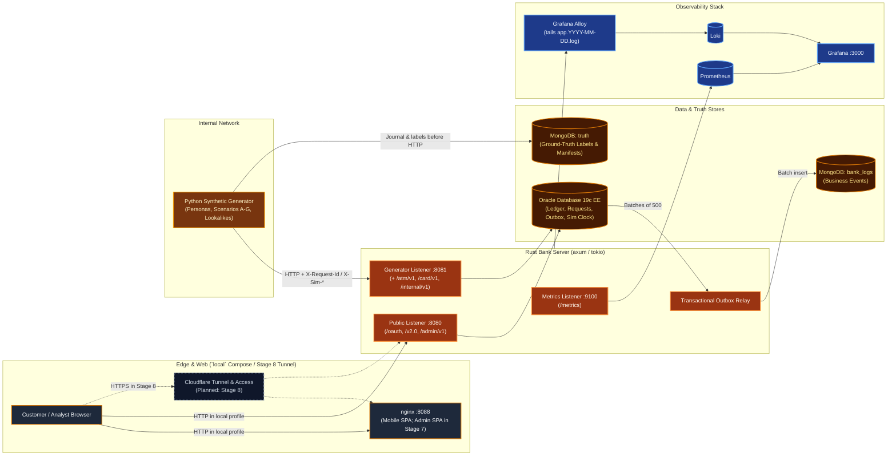

<div align="center">

# Saltation

**Simulated Korean Open-Banking server and synthetic fraud generator for real-time FDS & MLOps pipelines.**

**English** | [한국어](README.ko.md)

<br />


</div>

---

> **sal·ta·tion** (`/sælˈteɪʃən/`) — the leaping movement of sand grains across desert dunes, lifted by the wind or by vibrations beneath the surface.
>
> Borrowed from the desert physics of ***Dune***, where jumping grains of sand betray unseen movement beneath the dunes: a single transaction at rest looks like any other grain, and only in a continuous stream do hidden patterns take shape.

---

## Table of Contents

- [Overview](#overview)
- [System Architecture](#system-architecture)
- [Engineering Design](#engineering-design)
  - [1. Single-Entry KRW Ledger & Lock Ordering](#1-single-entry-krw-ledger--lock-ordering)
  - [2. Plain Oracle SQL & Pure-Rust `oracledb` Session Pool](#2-plain-oracle-sql--pure-rust-oracledb-session-pool)
  - [3. Transactional Outbox & Backpressure](#3-transactional-outbox--backpressure)
  - [4. Simulated Business Clock & Day Rollover](#4-simulated-business-clock--day-rollover)
  - [5. Channels: Open Banking, ATM & Card Network](#5-channels-open-banking-atm--card-network)
  - [6. Request Outcomes & Rejected Attempts](#6-request-outcomes--rejected-attempts)
- [Fraud Scenarios (A–G), Personas & Ground Truth](#fraud-scenarios-ag-personas--ground-truth)
- [Repository Layout](#repository-layout)
- [Quick Start](#quick-start)
- [Verification & Checks](#verification--checks)
- [Delivery Roadmap](#delivery-roadmap)
- [SDLC Control Plane](#sdlc-control-plane)

---

## Overview

Public fraud datasets are static tables. They provide no live event stream, no login, device, or session context, no cross-channel activity (mobile app, ATM, card network), and no way to inject a new fraud pattern and measure how a pipeline responds. Production banking data cannot be used outside a financial institution for privacy and regulatory reasons.

Saltation is a self-contained banking server and synthetic traffic generator built to serve as the data source for a real-time financial fraud anomaly detection MLOps pipeline:

1. **Banking Server (`bank/`)**: A Rust API server following the [KFTC Open Banking v3.3.6](spec.md) user-institution specification and the Korean financial MyData bank-sector logical data model in **Oracle Database 19c Enterprise Edition**. It provides demand deposit accounts, transfers, payees, zero-interest term deposits and loans, debit card payments, authentication, and device/session tracking across three channels (mobile web API, simulated ATM, simulated card network) plus a read-only analyst admin API.
2. **Synthetic Activity Generator (`generator/`)**: Uses an internal seeding interface and a simulated business clock to backfill activity over HTTP before switching to live traffic. The default workload targets 20,000 customers and 365 business days. The full-scale run is part of Stage 8. Customer personas (office worker, student, self-employed, elderly) run alongside fraud scenarios **A–G** and benign lookalikes. Ground-truth labels are written to an isolated database (`truth`) that the bank cannot access.
3. **Structured Ledger & Event Stream**: Relational state lives in Oracle Database; business events (`saltation.log/1`) are delivered to MongoDB (`bank_logs`) through a transactional outbox; operational JSON logs (`app.log`) and Prometheus metrics feed Loki and Grafana.

---

## System Architecture

The diagram shows the implemented stack alongside the planned **Stage 7** (Admin SPA) and **Stage 8** (Cloudflare Tunnel edge) components (dashed borders):



### Listeners & Network Boundaries

The bank container joins `edge`, `internal`, `data`, and `obs`. All three listeners bind inside the container on every interface. The table shows the intended caller network for each port. Compose publishes only the public bank listener to the host.

| Listener | Port / Intended caller network | Routes | Context Handling |
|---|---|---|---|
| **Public** | `:8080` (`edge`) | `/oauth/2.0/revoke`, customer `/v2.0/**` (except inbound deposit), `/admin/v1/**` | Ignores `X-Sim-*` headers; reads client IP and country from `CF-Connecting-IP` / `CF-IPCountry` (when behind Cloudflare in Stage 8); sets `human = true` on sessions. |
| **Generator** | `:8081` (`internal`) | Public routes plus `/v2.0/transfer/deposit/fin_num`, `/atm/v1/**`, `/card/v1/**`, `/internal/v1/**` | Port unpublished on the host; trusts `X-Request-Id` (ULID), `X-Sim-Ip`, `X-Sim-Region`, and `X-Sim-Device`; sets `human = false`. |
| **Metrics** | `:9100` (`obs`) | `/metrics` | Scraped by Prometheus on `obs` for request latency, per-statement SQL execution time, lock waits, pool utilization, outbox lag, and daily-close mismatches. |

---

## Engineering Design

### 1. Single-Entry KRW Ledger & Lock Ordering

[`bank/src/shared/ledger/`](bank/src/shared/ledger) is the only component that writes account balances, `ACCOUNT_TRANSACTION` rows, `TRANSFER` records, and `DAILY_ACCOUNT_TOTAL` rows. Ledger amounts are integers in Korean won (`NUMBER(15,0)`, 1 to 999,999,999,999 KRW).

```mermaid
sequenceDiagram
  autonumber
  participant C as Client / Generator
  participant B as Bank Handler
  participant Clk as Sim Clock Barrier
  participant O as Oracle 19c EE
  participant R as Outbox Relay
  participant M as MongoDB (bank_logs)

  C->>B: Money-moving request (idempotency key + payload)
  B->>Clk: Read business time once & pass operation barrier
  B->>O: INSERT INTO TRANSACTION_REQUEST (scope, key, request_hash)
  alt Duplicate idempotency key
    O-->>B: Unique constraint conflict -> wait & compare hash
    B-->>C: Return stored response (if hash matches) or 409 Conflict
  else New request
    B->>O: SELECT ... FOR UPDATE on accounts in ascending account_id order
    B->>O: Lock DAILY_ACCOUNT_TOTAL rows for business date
    B->>B: Validate status, ownership, balance, and limits
    alt Validation passes
      B->>O: Ledger writes TRANSFER, ACCOUNT_TRANSACTION, balances, daily totals
      B->>O: INSERT domain & request.completed events into OUTBOX; COMMIT
      B-->>C: 200 OK
    else Business rejection
      B->>O: Update TRANSACTION_REQUEST status = REJECTED + insert OUTBOX event; COMMIT
      B-->>C: Rejection response (zero balance change)
    end
  end
  R->>O: Read up to 500 undelivered OUTBOX rows in event_id order
  R->>M: Batch insert on _id = event_id (journaled write ack)
  R->>O: DELETE delivered rows from OUTBOX; COMMIT
```

- **Lock Ordering**: Operations affecting more than one in-bank account (`transfer`, `term_open`, `term_close`, `loan_disburse`, `loan_repay`) lock all affected accounts with `SELECT ... FOR UPDATE` in ascending `account_id` order in a single Oracle transaction.
- **Sign Rules (F-21)**:
  - Demand and term account balances represent money held; loan account balances represent principal owed.
  - `transfer`, `term_open`, and `term_close` between two in-bank accounts write two rows with equal and opposite amounts.
  - `loan_disburse` and `loan_repay` write two rows (on the demand account and loan account) with equal amounts and the same sign.
  - `card_payment` writes one row on the card's account with the negative KRW amount.

### 2. Plain Oracle SQL & Pure-Rust `oracledb` Session Pool

- **No ORM or Query Builder**: Every SQL statement lives in a separate `.sql` file under its feature's `sql/` directory (for example [`bank/src/features/transfers/sql/`](bank/src/features/transfers/sql)), is embedded at compile time, and executes with bind variables only. Each file header records the statement name, purpose, and expected access path for inspection via `EXPLAIN PLAN` / `DBMS_XPLAN.DISPLAY_CURSOR`.
- **Pure-Rust `oracledb` Adapter & FIFO Pool** ([`bank/src/shared/db/`](bank/src/shared/db)):
  - Uses Oracle's pure-Rust `oracledb` driver without Oracle Instant Client libraries in the container image.
  - Wraps the driver in an adapter-owned session pool that sets every session to `+09:00` (KST), assigns sessions to waiting requests in FIFO arrival order, and enforces bounded acquisition timeouts (returning a retryable `503` response when saturated).
- **SQL & Index Tuning** ([`docs/oracle-tuning-baseline.md`](docs/oracle-tuning-baseline.md), [`scripts/dev/oracle-tune/`](scripts/dev/oracle-tune)):
  - Evaluated against a 20,000-customer, 3-simulated-year schema (`SALTATION_TUNE`) using Active Session History (ASH), session counters, and `ALLSTATS LAST` cursor plans.
  - Consolidated redundant per-request round trips, adjusted index column order for history pagination and daily close, removed unused indexes, and verified optimizer statistics on restored outbox workloads.

### 3. Transactional Outbox & Backpressure

- **Dedicated 4 GB Tablespace (F-36a)**: `OUTBOX` is stored in a dedicated Oracle tablespace with `autoextend` capped at 4 GB so an event backlog cannot consume ledger storage. If the tablespace is full, transactions that must emit an event fail and roll back with a retryable error rather than dropping events.
- **Batched Relay**: [`bank/src/features/outbox_relay/`](bank/src/features/outbox_relay) reads up to 500 rows in `event_id` order, inserts them in batches into MongoDB `bank_logs.events` with journaled acknowledgment. Retries use the same `_id = event_id`, so duplicate-key errors can be ignored before deleting delivered rows from Oracle.
- **Backpressure Watermarks**: During backfill, the generator pauses request dispatch and clock advance when undelivered events exceed **50,000** and resumes when the backlog drops below **10,000**. `scripts/dev/it-oracle.sh outbox-outage` tests this by stopping MongoDB for 120 seconds under load.

### 4. Simulated Business Clock & Day Rollover

- **Dual-Mode Clock** ([`bank/src/shared/clock/`](bank/src/shared/clock)): Business time is persisted in Oracle (`SIM_CLOCK`). Every operation reads business time once at the start of execution and records both `occurred_at` (business time) and `recorded_at` (system wall-clock time). No business time column uses a database default.
- **Clock Barrier**: In `backfill` mode, advancing the clock waits for in-flight operations to finish (up to 10 seconds) and blocks new operations until day rollover finishes. Switching to `live` mode is one-way and binds business time to wall-clock time.
- **Day Rollover Jobs** ([`bank/src/shared/rollover/`](bank/src/shared/rollover)): Crossing a business date runs registered rollover jobs in date order:
  1. **Term-Deposit Maturity**: Returns principal to the linked demand account and closes matured term accounts.
  2. **Dormancy**: Marks accounts with no customer-initiated transaction for 365 business days as `dormant` (and reactivates them on the next customer-initiated transaction), logging transitions in `ACCOUNT_STATUS_HISTORY`.
  3. **Daily Close** ([`bank/src/features/daily_close/`](bank/src/features/daily_close)): Checks that `opening_balance + sum(day_rows) == last_balance_after` per account and business date and that all `TRANSFER` rows satisfy F-21, writing results to `DAILY_CLOSE`.

### 5. Channels: Open Banking, ATM & Card Network

- **Mobile Open Banking (`/v2.0/**`)**: Follows KFTC v3.3.6 paths, field lengths (`aNS`, `N`, `AN`, character-counted Korean `AH(n)`), and response codes. Supports phone/password login (5-failure 30-minute lockout), SMS-outbox password reset, device tracking, payees, recipient inquiry, transfers, inbound counterparty deposits (`oob` scope), term deposits, and loans.
- **ATM Channel (`/atm/v1/**`)**: Generator-driven endpoints for seeded Korean ATM terminals with latitude/longitude coordinates. Enforces 3-failure PIN lockouts until the next business day, 3-minute sessions, and cash withdrawal limits (1,000,000 KRW per transaction, 6,000,000 KRW per day).
- **Card Network Channel (`/card/v1/authorize`)**: Authenticated with `card` client credentials. Converts foreign currencies at fixed integer rates (`KRW`, `USD` @ 1,300, `EUR` @ 1,400, `JPY` @ 900 per 100 yen, `CNY` @ 200), validates ISO 3166-1 alpha-2 country codes and 4-digit MCCs, and requires coordinates for `in_person` payments while rejecting them for `online` payments. Approved and declined authorizations are both recorded.

### 6. Request Outcomes & Rejected Attempts

- **`request.completed` Events**: Eligible API requests on the public or generator listener write one `request.completed` outbox event with route template, HTTP status, response codes, and duration (recorded in the handler transaction for state changes or by middleware for reads and early rejections). Outcome recording excludes `OPTIONS`, `/healthz`, `/metrics`, and `/internal/**`.
- **Rejected Money-Moving Attempts**: Rejected money-moving requests (`401`, `403`, locked credentials, wrong PIN, insufficient balance, limit exceeded, blocked/unknown card, idempotency conflict, or reused request ID) are recorded as rejected attempts in `TRANSACTION_REQUEST`. Rejections after a transfer claims its idempotency key, such as insufficient balance, keep the key and the response for replay.

---

## Fraud Scenarios (A–G), Personas & Ground Truth

[`generator/saltation_gen/`](generator/saltation_gen) drives four customer personas (**office worker**, **student**, **self-employed**, **elderly**) alongside fraud actors and benign lookalikes.

### Scenario Matrix

"Year" is the target instance count across a 365-day backfill for 20,000 customers at the default amplification factor (`20x`); "Live" is the minimum during a 24-hour live run.

| ID | Scenario | Generator Actions | Required Oracle & `bank_logs` Records | Year (365d) | Live (24h) |
|---|---|---|---|---:|---:|
| **A** | **Account Takeover** | Failed-login burst from a new device and foreign/unseen region; SMS password reset; login; payee registration; high-value transfer | `LOGIN_ATTEMPT` failures, `PASSWORD_RESET`, `DEVICE`, `PAYEE`, `TRANSFER`; `login.failed`, `password_reset.*`, `device.new`, `payee.added`, `request.completed` | 200 | 2 |
| **B** | **Voice-Phishing Victim** | Elderly-leaning victim on own device; early close of term deposit or loan disbursement; transfers to new payees (mule accounts **C**); large ATM withdrawals | `TRANSFER` (`term_close` / `loan_disburse`), `transfer` rows to **C** accounts, `atm_cash` rows, `ATM_SESSION`; `atm.*` events | 200 | 2 |
| **C** | **Money Mule Account** | New or dormant account receives transfers from **B** victims and external senders, followed by ATM withdrawals; shares device IDs or IPs with other mules | Inbound `transfer` & `inbound` rows, `atm_cash` rows, `ACCOUNT_STATUS_HISTORY` (`dormant` → `active`), shared `DEVICE` IDs | 100 accts | 2 |
| **D** | **Structuring** | Cash deposits split across ≥ 3 business days and ≥ 2 accounts, keeping daily cash-in per account between 9,000,000 and 9,999,999 KRW (below the 10M KRW threshold) | `atm_cash` rows, `DAILY_ACCOUNT_TOTAL` cash-in | 100 | 2 |
| **E** | **Velocity / Amount Anomaly** | Standalone burst of transfers or a single transfer far above the customer's baseline, without A–D or G patterns | `transfer` rows | 300 | 2 |
| **F** | **Time / Location Anomaly** | Standalone activity at hours the persona does not use or from an unusual/foreign region, without A–D or G patterns | `LOGIN_ATTEMPT`, `AUTH_SESSION` with region, `request.completed` events | 300 | 2 |
| **G** | **Card Misuse Abroad** | Foreign-currency card payments (`USD`, `EUR`, `JPY`, `CNY`) in person or online at unseen foreign merchants while the customer's sessions/ATM use within a 24h window are in Korea | `CARD_AUTHORIZATION` (approved & declined), `card_payment` rows, domestic `AUTH_SESSION` / `ATM_SESSION`; `card.authorized`, `card.declined` | 200 | 2 |
| **—** | **Benign Lookalikes** | Foreign travel, trip abroad with in-person card payments, foreign online shopping, new phone, one-off large purchase, shared household network | Overlaps with **A**, **E**, **F**, and **G** in amount, hour, and country | 2,000 | 7 |

### Ground-Truth Isolation

- **Separate Database Users**: The generator writes labels and run manifests to the MongoDB `truth` database using the `generator` user. The bank's MongoDB user (`bank`) is granted access only to `bank_logs`, and the generator has no Oracle credentials.
- **Pre-Request Journaling**: The scenario drivers persist recovery journal entries and one label per involved account or customer before dispatch. Labels are keyed by `(request_id, subject_type, subject_id)`. The quick-start `run-normal` command records labels before dispatch.
- **Dual-Account Labels**: A transfer from a **B** victim to a **C** mule account records label `B` on the sender's account and label `C` on the receiver's account under the same `request_id`.

---

## Repository Layout

Code is organized by feature (vertical slices) with one-way dependency rules (`app -> features -> shared`) enforced by automated checks.

```text
saltation/
├── contracts/                 # OpenAPI 3.1 specs, log envelope JSON Schema, code tables
│   ├── openapi/               # public.yaml, atm.yaml, card.yaml, admin.yaml, internal.yaml
│   ├── schemas/               # saltation.log/1 event envelope schema
│   └── codes/                 # Response codes, bank codes, ISO country & currency tables
├── bank/                      # Rust banking API server (axum, tokio, oracledb, mongodb)
│   ├── migrations/            # Numbered plain-SQL Oracle schema migrations (0001..0021)
│   ├── src/
│   │   ├── shared/            # db pool, ledger, clock, rollover, outbox, auth, context, api, telemetry
│   │   └── features/          # auth, accounts, transfers, inbound, payees, deposits, loans, atm, cards,
│   │                          # accounts_lifecycle, daily_close, admin, internal, outbox_relay
│   └── tests/                 # Contract, pool, SQL access-plan, and Oracle integration tests
├── generator/                 # Python 3 synthetic traffic & fraud scenario generator
│   ├── saltation_gen/         # personas/, scenarios/, drivers/, client/, truth/, config/
│   └── tests/                 # Schedule, wire-format, backpressure, and journal recovery tests
├── web/                       # TypeScript + React workspace (pnpm)
│   ├── apps/mobile/           # Customer mobile web SPA (Korean UI; expanded in Stage 7)
│   └── packages/api-client/   # Typed client generated from contracts/ (apps/admin arrives in Stage 7)
├── infra/                     # Container and runtime configuration
│   ├── compose/               # Docker Compose stack (local, ci, tools profiles; N-7 resource limits)
│   ├── oracle/                # Oracle Database 19c EE (19.19) image build, setup SQL, smoke scripts
│   ├── mongo/                 # MongoDB init scripts (bank_logs and truth users)
│   ├── nginx/                 # Static SPA server config
│   └── observability/         # Grafana Alloy, Loki, Prometheus, and Grafana provisioning
├── changes/                   # SDLC change packets (change.json, intent.md, spec.md, plan.md)
├── scripts/                   # Control plane (repo.py, hooks/guard.py) & containerized runners (scripts/dev/)
├── docs/                      # Reference docs (dev-host.md, oracle-tuning-*, test-speed.md, host-setup.md)
├── intent.md                  # Product baseline: problem, outcomes, constraints, success criteria
├── spec.md                    # Product baseline: functional (F-1..F-43) & non-functional (N-1..N-13) spec
└── checks.json                # Registered verification checks routed by path and group
```

---

## Quick Start

All build and test toolchains run in containers. The host requires **Docker** (with Compose and Buildx), **Git**, **Bash**, and **Python 3**. See [`docs/dev-host.md`](docs/dev-host.md) for host setup details.

### 1. Build the Oracle Database 19c EE Image

Build `saltation/oracle-ee:19.19` locally from the Oracle 19c installation zip downloaded under the OTN developer license:

```sh
ORACLE_ZIP=/path/to/LINUX.ARM64_1919000_db_home.zip infra/oracle/build.sh
infra/oracle/smoke.sh
```

### 2. Start the Compose Stack (`local` Profile)

```sh
cp infra/compose/.env.example infra/compose/.env    # replace placeholder values with local secrets
docker compose -f infra/compose/compose.yml --env-file infra/compose/.env --profile local up -d --build --wait
```

First-time database creation takes 10–20 minutes; subsequent starts reuse the existing volume.

Default host loopback bindings in [`infra/compose/compose.yml`](infra/compose/compose.yml):

| Service | Host Loopback Address | Notes |
|---|---|---|
| **Mobile Web App** | `http://localhost:8088` | Customer mobile web SPA |
| **Bank Public Listener** | `http://127.0.0.1:8080/healthz` | Open Banking (`/v2.0/**`) & Admin (`/admin/v1/**`) API |
| **Grafana** | `http://127.0.0.1:3000` | `Saltation bank` dashboard, Loki logs, Prometheus metrics |
| **Oracle Database 19c EE** | `127.0.0.1:1521` | Configured via `ORACLE_PUBLISH` (default `127.0.0.1:1521`) |
| **MongoDB** | `127.0.0.1:27017` | Configured via `MONGO_PUBLISH` (default `127.0.0.1:27017`) |

The bank's generator listener (`:8081`) and metrics listener (`:9100`), Alloy, Loki, and Prometheus are not published to the host.

### 3. Seed Data & Run the Generator

A new database starts in `backfill` mode. Use the `generator` service (`tools` profile) to seed customers and counterparties, switch the clock to `live`, and generate transfers:

```sh
docker compose -f infra/compose/compose.yml --env-file infra/compose/.env --profile tools run --rm generator seed --customers 1000
docker compose -f infra/compose/compose.yml --env-file infra/compose/.env --profile tools run --rm generator seed-parties --counterparties 50
docker compose -f infra/compose/compose.yml --env-file infra/compose/.env --profile tools run --rm generator clock show
docker compose -f infra/compose/compose.yml --env-file infra/compose/.env --profile tools run --rm generator clock live
docker compose -f infra/compose/compose.yml --env-file infra/compose/.env --profile tools run --rm generator run-normal --minutes 10 --rate 5
```

---

## Verification & Checks

Checks are registered in [`checks.json`](checks.json) and routed by changed paths. Run all checks with:

```sh
python3 scripts/repo.py verify --change <id> --full
```

| Group | Check IDs | Command | Scope |
|---|---|---|---|
| `core` | `control-plane` | `python3 scripts/tests/run.py` | `repo.py`, `guard.py`, SDLC gates, and path routing tests |
| `rust` | `rust-fmt`, `rust-clippy`, `rust-unit` | `scripts/dev/ci-rust.sh fmt\|clippy\|test` | Rust formatting, Clippy lints, unit tests, and contract validation |
| `web` | `web-lint`, `web-typecheck`, `web-test`, `web-build` | `scripts/dev/ci-web.sh lint\|typecheck\|test\|build` | ESLint, TypeScript type checking, Vitest tests, and SPA build |
| `python` | `py-lint`, `py-test` | `scripts/dev/ci-py.sh lint\|test` | Ruff lints and pytest suites for the generator |
| `oracle` | `compose-config`, `oracle-integration`, `mobile-browser-dates` | `scripts/dev/it-oracle.sh all`, `browser-dates` | End-to-end Oracle 19c + MongoDB integration suites across backfill and live modes |

To run an individual integration suite against the reusable `saltation-it` test database:

```sh
scripts/dev/it-oracle.sh transfers
scripts/dev/it-oracle.sh outcomes
scripts/dev/it-oracle.sh outbox-outage
scripts/dev/it-oracle.sh e2e
```

---

## Delivery Roadmap

Delivery follows the stages in [`spec.md` § Delivery](spec.md). **Stages 1–6 are merged on `main`.**

| Stage | Scope | Deliverables | Status |
|---:|---|---|---|
| **1** | **Walking Skeleton (`product-init`)** | Root [`intent.md`](intent.md) & [`spec.md`](spec.md); Compose stack (`local` profile); core migrations; login, balance, history, transfer, outbox relay, initial mobile flow, basic generator | **Merged** |
| **2** | **Ledger & Products (API Server)** | Payees, recipient inquiry, limits, inbound deposits, term deposits, loans, password reset, devices, simulated clock & day rollover, daily close, request outcomes & rejected attempts | **Merged** (`#8`, `#9`) |
| **3** | **ATM Channel (API Server)** | `/atm/v1/**` endpoints, terminal coordinates, PIN credentials & lockouts, 3-minute sessions, cash deposit/withdrawal postings | **Merged** (`#11`) |
| **4** | **Card Channel (API Server)** | Debit card schema & seeding, `card` client tokens, `/card/v1/authorize` with fixed-rate FX conversion, MCCs, and merchant coordinates | **Merged** (`#16`, `#18`) |
| **5** | **Admin Interface (API Server)** | Analyst login (`/admin/v1/login`) and read-only lookup endpoints backing F-39 | **Merged** (`#19`) |
| **6** | **Generator Scenarios** | Personas, scenarios **A–G**, lookalikes, crash-recoverable truth journal & dual-subject labels, backfill clock & outbox hysteresis, run manifests | **Merged** (`#20`) |
| **—** | **Driver & Oracle Tuning** | Pure-Rust `oracledb` driver & FIFO session pool (`#13`), KST browser dates (`#12`), test speedups (`#14`, `#21`), Oracle SQL/index tuning (`#15`, `#17`, `#22`) | **Merged** |
| **7** | **Web UI** | Remaining F-38 mobile screens (password reset, payees, recipient inquiry in transfer flow, products, term deposits, loans) and the F-39 analyst admin web app | **Up Next** |
| **8** | **Operations** | Cloudflare Tunnel exposure & negative tests, Grafana dashboards, retention, N-1..N-3 load tests, 365-day backfill + 24-hour live run | **Planned** |

---

## SDLC Control Plane

The repository enforces an artifact-driven development workflow ([`changes/README.md`](changes/README.md)):

```text
idea
  -> changes/<id>/  (intent.md -> spec.md -> plan.md, approved in order via digest-bound claims)
  -> implementation + verification inside write_scope
  -> copy accepted intent/spec to the root baseline
  -> pull request (Change-ID: <id>) -> CI summary check -> owner review & squash merge
```

- **Baseline & Packets**: Root [`intent.md`](intent.md) and [`spec.md`](spec.md) hold the current baseline. Each change is tracked in `changes/<id>/` (`change.json`, `plan.md`, and optional `intent.md` / `spec.md`).
- **Enforcement Layers**:
  1. **Hard Gate**: `python3 scripts/repo.py status` and `python3 scripts/repo.py verify` validate stage order, artifact freshness, approvals, and `write_scope`, enforced in CI by the `summary` job.
  2. **In-Session Guard**: [`scripts/hooks/guard.py`](scripts/hooks/README.md) blocks direct edits to the root baseline, merged packets, and approvals.
  3. **Instructions & Skills**: [`AGENTS.md`](AGENTS.md), [`REVIEW.md`](REVIEW.md), and [`.agents/skills/`](.agents/skills).

---

## License

[MIT License](LICENSE). Oracle Database 19c Enterprise Edition installation binaries are not included in this repository and are used under the owner's developer license for personal portfolio development and demonstration.
